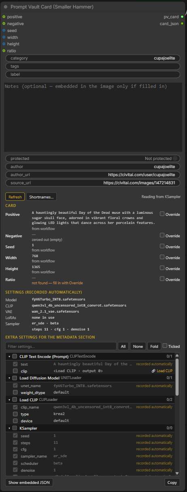
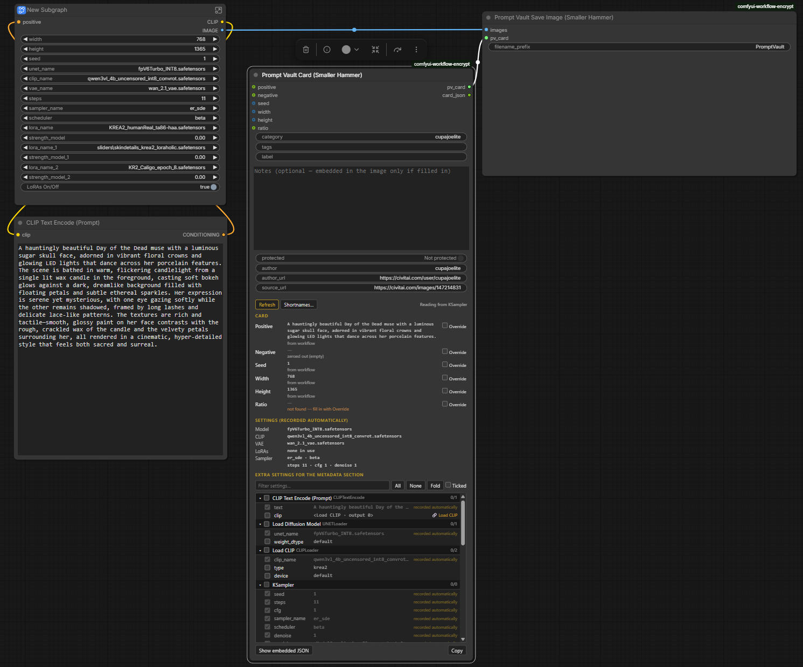

# Prompt Vault Card (Smaller Hammer)

ComfyUI nodes that embed a Prompt Vault card in every saved PNG: prompt, negative, seed,
size, ratio, category, tags and credit, plus the model, CLIP, VAE, LoRAs and sampler
settings. [Prompt Vault Desktop](https://github.com/danger-uxb/prompt-vault-desktop) v7.0
or newer reads it on import and fills the card in: drop the PNGs onto its Library.



A Smaller Hammer node pack · v1.2.0 · targets ComfyUI 0.43.2 / Desktop 1.1.8.

## Installing

On this page, click the green **Code** button, then **Download ZIP**. Extract it and copy
the folder (`comfyui-prompt-vault-card-main`, any name works) into `ComfyUI/custom_nodes/`,
or `git clone` this repository there. Restart ComfyUI and refresh its browser tab. No
extra Python packages are needed.

| File | Purpose |
|---|---|
| `__init__.py` | Registers the nodes, the panel script and the preview routes. |
| `nodes.py` | Prompt Vault Card and Prompt Vault Save Image. |
| `pv_core.py` | Works the card out from the workflow. No ComfyUI imports. |
| `pv_store.py` | The shortname table. |
| `routes.py` | The panel's live preview and the shortname editor. |
| `web/js/prompt_vault_card.js` | The Card node's panel. |
| `pyproject.toml`, `LICENSE` | Package metadata and the MIT licence. |
| `docs/` | The screenshots on this page. |

The nodes are under **Smaller Hammer › Prompt Vault**.

## Wiring

```
Prompt Vault Card --pv_card--> Prompt Vault Save Image <--images-- VAE Decode
```

Delete or bypass your old Save Image node, so pictures are not saved twice. Any save node
with a `PV_CARD` input can take the card instead of Prompt Vault Save Image.



The Card node needs nothing wired in to work: it reads the workflow. Wire an input only
to replace what it finds.

## Where each card field comes from

Each field takes the first of these that gives a value:

1. **Override** — tick Override beside the field on the panel and type the value.
2. **Wired input** — `positive`, `negative`, `seed`, `width`, `height`, `ratio`.
3. **The workflow** — traced from the sampler:
   - prompt and negative: back through the conditioning to the text node. A
     Conditioning Zero Out gives an empty negative.
   - seed: the sampler's seed, as used for that run.
   - width and height: the latent size. An **Olm Resolution Picker** is read directly,
     swap flag included.
   - ratio: the ratio in the Olm label (`(16:9)`, flipped when swapped). Otherwise an exact
     ratio only when it is a standard one (both terms 21 or less, e.g. 2:3). Anything else
     is left blank for you to fill in with Override — it is never calculated to `17:30`.

The panel shows each value and its source before you run. With more than one sampler, pick
the one to read from at the top of the panel.

**Prompts read from files while running** (prompt-list nodes, wildcard loaders) are not
in the workflow itself. Wire the node's prompt text output into the Card node's `positive`
input; for Smaller Hammer's Prompt List Encode that is its `prompt` output.

## Settings and LoRAs

Model, CLIP, VAE, sampler, scheduler, steps, CFG and denoise are recorded automatically.
LoRAs are found by following the sampler's model chain, so only the LoRAs actually in use
are recorded — a LoRA behind a switch that is off, or set to strength 0, is left out. Anything else you tick in the
panel's list goes into the card's metadata section.

**Shortnames** (panel › Shortnames…) are recorded instead of the file name. The table is
shared by every workflow and kept in `ComfyUI/user/smallerhammer/pv_shortnames.json`, so it
survives updating this pack. Subfolders are always stripped (`sliders\skin.safetensors` is
recorded as `skin.safetensors`).

## What goes in the image

A text chunk named `promptvault`, next to ComfyUI's usual `prompt` and `workflow`
chunks, so the image still loads back into ComfyUI. It is written even when ComfyUI runs
with `--disable-metadata`, because wiring a card in is an explicit request.

**Credit fields** — author, author URL and image source URL — are optional and go into the
card as typed. Prompt Vault keeps them per variant.

**PNG metadata is plain text and travels with the image.** Notes are embedded only if
you fill them in, and Protected only if you switch it on. Both are off by default.

The screenshots show cupajoelite's Day of the Dead prompt, used with permission
([cupajoelite](https://civitai.com/user/cupajoelite), original image
https://civitai.com/images/147214831).

## Try the result

Prompt Vault Desktop ships with six sample PNGs saved by these nodes (prompts by
[cupajoelite](https://civitai.com/user/cupajoelite), used with permission). Drop them onto
its Library to see what an imported card looks like.

Tip of the day: If the bad boom egg goes off, tuck and roll. It won't do anything, but you'll briefly look cool.
Keep safe and its always that curly yellow wire.. Chonky
~~~
 (\(\
 (._.)
c(___)
~~~

## Licence

MIT — see [LICENSE](LICENSE). © 2026 Smaller Hammer · MIT Licence
